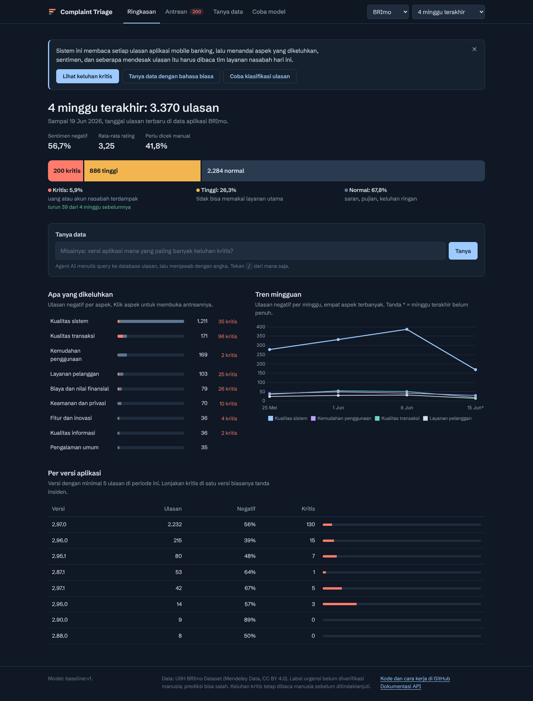
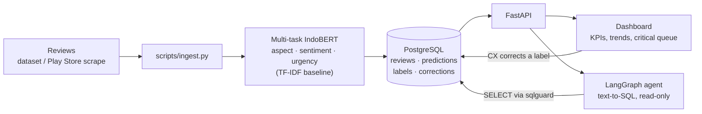

# Complaint Triage System: complaint triage and analytics for Indonesian mobile banking reviews

A bank's mobile app collects thousands of Play Store reviews a month. Most are "mantap" or "aplikasi
jelek". A few say *"transfer gagal tapi saldo terpotong, sudah 3 hari"*, and those are customers whose
money is stuck right now. Complaint Triage System reads every review and labels its **service aspect**, **sentiment**
and **urgency**. It puts the critical ones in a queue for the CX team, shows which aspects and app
versions are driving complaints, and lets a manager ask questions about the data in plain Indonesian.

**Live demo:** [ISI: URL Modal] (serverless: the first visit after a quiet period takes up to a minute while the model loads)

> **Status: v0.1, first results on real data.** The pipeline, API, dashboard, agent and deployment are
> complete and tested. Aspect and sentiment use the dataset's own labels. **Urgency labels are silver
> (not yet human-verified)**: keyword rules and an LLM cross-check each other; human review of the test
> period is the next step (see [Data](#data)). Fine-tuned IndoBERT beats the TF-IDF baseline on every
> task and halves the share of predictions a person has to check (see [Results](#results)).



## The problem

From January to mid-September 2026, OJK's consumer-protection portal received **82,092 complaints**.
**26,091** of them were about banks
([Kontan, 5 Oct 2026](https://keuangan.kontan.co.id/news/ojk-terima-82092-pengaduan-lewat-aplikasi-portal-perlindungan-konsumen-per-september)).
Those are only the customers who escalated. Many more complain where it is easiest: an app-store review.

A CX team reading reviews by hand runs into three problems:

1. **Volume.** Critical complaints (money deducted, unknown transactions, a hijacked account) are a small
   share, buried among praise and one-word ratings. A review written on Friday night is read on Monday.
2. **No structure.** "Ratings dropped this week" does not say *why*. Product needs "complaints about failed
   payments tripled after version 3.2.0", not a star average.
3. **Questions need an analyst.** "Which aspect got worse this month, and show me examples" means asking
   someone to write SQL and waiting for the answer.

The people hurt are the customers whose money is stuck while their review waits in a pile, and the CX and
product teams who find out about an incident from social media instead of their own data.

## How it works



- **One encoder, three heads.** IndoBERT (`indobenchmark/indobert-base-p1`) with mean pooling and one
  linear head per task, trained in a custom PyTorch loop. The loss is masked per task, so a review can
  have aspect and sentiment labels (from the dataset) without an urgency label (hand-annotated subset).
- **Urgency** comes from the model when it has an urgency head. Otherwise it comes from keyword rules
  (`complaint_triage/rules.py`). The rules also pre-label reviews for annotation and serve as the urgency
  baseline.
- **Low-confidence predictions** (below 0.55 on any task) are flagged *perlu dicek* (needs checking).
  When a CX agent changes a label in the queue, the change is stored as a correction and becomes training
  data for the next model.
- **The agent** is a LangGraph graph with two tools: `run_sql` (read-only queries on one view) and
  `label_guide`. The answer comes back with the SQL it ran, so a person can check it.

## Data

| Source | Use | Labels |
|---|---|---|
| [USH BRImo Dataset](https://data.mendeley.com/datasets/7253k33f62/1) (Mendeley Data, CC BY 4.0, DOI 10.17632/7253k33f62.1) | Train / val / test | 100,000 Play Store reviews of BRImo; 9 service aspects and 3 sentiments come with the dataset |
| Urgency annotation, self-made | Train / val / test | 800 sampled reviews, *kritis / tinggi / normal* ([guide](docs/annotation_guide.md)). **v0.1: silver labels** from keyword rules cross-checked with an LLM; human review in Label Studio planned for v0.2 |
| Play Store reviews of other bank apps, self-scraped (`scripts/scrape_play.py`) | **External test only** | Hand-labelled sample; tests whether a model trained on one bank's app generalises to another |
| `data/sample/demo_reviews.jsonl` | Demo and tests only | 448 **fictional** reviews of two fictional apps, generated by `scripts/make_demo_data.py` |

What the dataset looks like (`scripts/inspect_dataset.py`, before any cleaning):

| | |
|---|---|
| Reviews | 100,000, July 2025 to June 2026, 112 app versions (18% have no version) |
| Sentiment | Positif 72.7%, Negatif 25.6%, Netral 1.7% |
| Aspect | General 46%, System quality 19%, Usability 13%, Transaction quality 12%, the other five 1–3% each |
| Length | Median 3 words; 42% are under 3 words ("ok", "mantap") |
| Duplicates | 41% of texts appear more than once |
| Usable after import | **52,098 reviews** (at least 3 words, exact duplicates removed) |

Choices that matter:

- **Time split, not random.** The newest 15% of reviews are the test set. In production the model scores
  reviews written after it was trained, against app versions it has never seen. A random split would
  hide that drift.
- **Exact duplicates removed before splitting.** App reviews repeat a lot ("mantap", "aplikasi bagus").
  Without this step the same text lands in train and test.
- **No personal data.** The dataset's reviewer column is already pseudonymised (`User000001`) and is not
  imported anyway, and neither are names or profile pictures from scraped reviews. Raw files stay in `data/raw/`, which is git-ignored.
- **Label quality is checked, not assumed.** The dataset page does not say how its labels were produced,
  and a first look finds noise: 985 reviews have a 1-star rating and a *Positif* label, and most of the
  ones read by hand are complaints ("Jelek keluar masuk terus"). The 3,928 five-star *Negatif* reviews, by
  contrast, are mostly real complaints from people who still gave five stars. Planned for v0.2: re-label
  200 random reviews by hand and report the agreement with the dataset labels.
- **Netral is 1.7% of the data.** Macro-F1 is reported so the model cannot score well by ignoring it, and
  per-class results are in `docs/results.md`.
- **Urgency labels, v0.1 (silver).** Two independent first passes label the 800-review sample: the
  keyword rules and an LLM (Claude, `data/annotation/second_opinion.jsonl`, committed). They agree on
  595 of 800. Training and validation keep only the 504 agreed labels; the test period (122 usable
  reviews) uses the LLM label; disagreements and reviews the LLM marked unsure are left out
  (`scripts/labelstudio.py silver`, provenance in `docs/label_provenance.json`).
- **What that means for the numbers.** Urgency scores in v0.1 measure agreement with the LLM, not with
  human judgement, and the training labels are the cases rules and LLM both find easy. That is why the
  validation urgency score (0.975) is far above the test score (0.805). **v0.2:** every test-period
  review decided by a person in Label Studio (`crosscheck` puts them at the top of the list), then
  `merge`. The test period holds only 11 critical reviews, so one review moves critical recall by 9%.
- **The urgency sample is enriched**: 20% flagged *kritis* by the rules, 20% flagged *tinggi*, 35% other
  negative reviews, 25% the rest, because critical reviews are rare. For scale: on all 52,098 reviews the
  rules flag 1.0% as *kritis* and 7.6% as *tinggi* (a rule-based estimate, not a human count).

Citation: Pratama, M. A. et al. (2026). *USH BRImo Dataset: Aspect-Based Sentiment Analysis of BRImo
Mobile Banking Reviews*. Mendeley Data, V1. doi:10.17632/7253k33f62.1

## Models and trade-offs

| Decision | Why | Cost |
|---|---|---|
| **Fine-tuned IndoBERT** instead of prompting an LLM per review | Scoring 100k reviews with an LLM means 100k paid calls and minutes of latency. The fine-tuned model scores about 7 reviews/s on a Colab CPU and a full backfill takes minutes on a free GPU, at no cost per review, and its output is the same every run | Needs labelled data and a GPU to train (free Colab T4 is enough) |
| **One multi-task model** instead of three | One encoder pass per review gives three labels. A third of the memory and latency | Tasks compete; urgency gets loss weight 2.0 so it is not drowned out by the much larger aspect/sentiment set |
| **TF-IDF + logistic regression baseline** kept | The bar IndoBERT must clear, and the fallback that runs without torch (small Docker image) | Weaker on paraphrases and slang |
| **Model selection on mean macro-F1 + critical recall** | Missing a critical complaint costs more than reading one extra review | More false alarms in the queue; the threshold and the precision are reported |
| **LLM only for the agent** | The agent writes a few SQL queries per question, which is where an LLM is worth its cost. Free tier: Groq `openai/gpt-oss-20b`, any OpenAI-compatible endpoint works | Answers depend on an external service; rate limited to 5 questions per minute per client |

### Text-to-SQL safety

The LLM writes SQL, so it is treated as untrusted input. There are three layers:

1. `complaint_triage/sqlguard.py`: one statement, `SELECT`/`WITH` only, only the `v_reviews` view, no write
   keywords or dangerous functions (`pg_sleep`, `pg_read_file`, `dblink`, ...), and a row limit of 200
   is always added.
2. The query runs in a `READ ONLY` transaction with a 5-second `statement_timeout`.
3. In deployment the agent connects as `agent_ro` (`sql/readonly_role.sql`), a role that can only
   `SELECT` from the view.

A rejected query is returned to the LLM as text ("QUERY REJECTED: table 'reviews' is not available"), so
it can correct itself. Every run is logged to `agent_log` with its question, queries, steps, latency and
tokens.

## Results

Test set: newest 15% of USH BRImo reviews (time split, 7,814 reviews, 23 Apr to 19 Jun 2026). Filled by
`scripts/evaluate.py`; full report in `docs/results.md`. An external test set (other banks' apps, never
trained on) is planned for v0.2.

Aspect and sentiment are scored on all 7,814 test reviews against the dataset labels. **Urgency is scored
on 122 reviews with silver labels (11 critical)**, see above.

| Model | Aspect macro-F1 | Sentiment macro-F1 | Urgency macro-F1 (silver) | Critical recall (silver, n=11) | Needs review | Latency p50 (CPU) | Size |
|---|---|---|---|---|---|---|---|
| Keyword rules (urgency only) | – | – | 0.637 | 0.636 | – | <1 ms | – |
| TF-IDF + LogReg | 0.591 | 0.652 | 0.805 | 1.000 | 39.2% | 6.9 ms | 33.7 MB |
| **IndoBERT multi-task** (3 epochs, 9 min on a Colab T4) | **0.612** | **0.687** | **0.853** | 1.000 | **21.3%** | 111 ms | 499 MB |

Latency is one review at a time on a Colab CPU. *Needs review* is the share of reviews where any
prediction is below 0.55 confidence and the dashboard flags it for a person.

What the numbers say:

- **IndoBERT wins on every task**, by 2.1 points on aspect, 3.5 on sentiment and 4.8 on (silver) urgency.
  Both learned models beat the keyword rules on urgency by a wide margin (0.80 to 0.85 against 0.64).
- **The bigger win is operational.** IndoBERT is confident on more reviews, so the share a CX agent has to
  check falls from 39% to 21%. BRImo gets about 4,300 reviews a month that pass the 3-word filter, so
  that is roughly 780 fewer manual checks a month.
- **It costs about 15x the latency and 15x the size.** 111 ms per review is fine for the live API, but scoring a
  large backlog on CPU is slow (about 7 reviews/s), so backfills run in batch on a GPU.
- **Aspect is the hard task** (0.61): nine classes, many one-line reviews, and label noise in the dataset
  (see Data). Per-class scores are in `docs/results.json`.
- **Critical recall of 1.000 is not a claim**: 11 critical reviews with silver labels. It will be
  re-measured on the human-verified test set in v0.2.

Agent, on `data/agent_eval/questions.jsonl` (questions with a known answer from hand-written SQL):
[ISI: x/5 benar, rata-rata langkah, rata-rata token] (`scripts/eval_agent.py`).

## Run it

Locally with Docker (PostgreSQL + API + fictional demo data):

```bash
cp .env.example .env        # add LLM_API_KEY to enable "Tanya data"; .env is git-ignored
docker compose up --build
# http://localhost:8000      dashboard
# http://localhost:8000/docs API
```

Without Docker:

```bash
python -m venv .venv && source .venv/bin/activate      # Windows: .venv\Scripts\activate
pip install -r requirements.txt
python scripts/make_demo_model.py
uvicorn app.main:app --reload                           # classification only; set DATABASE_URL for the rest
```

Real data, from raw file to deployed model:

```bash
pip install -r requirements-data.txt
# Put the CSV from the Mendeley zip ("USH Brimo Dataset", no extension) in data/raw/
python scripts/inspect_dataset.py "data/raw/USH Brimo Dataset"
python scripts/import_reviews.py "data/raw/USH Brimo Dataset" data/interim/brimo.jsonl \
    --app BRImo --source ush_brimo --text-col Ulasan --aspect-col Aspek --sentiment-col Sentimen \
    --rating-col Rating --date-col Tanggal --version-col "Versi App" --id-col none
python scripts/labelstudio.py sample data/interim/brimo.jsonl data/interim/ls_urgency.json --n 800
python scripts/labelstudio.py crosscheck data/interim/ls_urgency.json data/annotation/second_opinion.jsonl \
    data/interim/ls_urgency_crosscheck.json
#   ... annotate urgency in Label Studio, export JSON ...
python scripts/labelstudio.py merge data/interim/brimo.jsonl data/interim/ls_export.json data/annotated/brimo.jsonl --tasks data/interim/ls_urgency_crosscheck.json
python scripts/prepare_data.py data/annotated/brimo.jsonl data/processed --external data/annotated/bank_lain.jsonl
python scripts/train_baseline.py data/processed models/baseline --version v1
# GPU (notebooks/train_colab.ipynb):
python scripts/train_multitask.py data/processed models/indobert-mt
python scripts/evaluate.py data/processed --baseline models/baseline --multitask models/indobert-mt
DATABASE_URL=... python scripts/ingest.py data/annotated/brimo.jsonl --model models/indobert-mt
```

Tests (PostgreSQL tests run when `TEST_DATABASE_URL` points at an empty database):

```bash
pip install -r requirements-dev.txt
ruff check . && pytest
```

### API

| Endpoint | |
|---|---|
| `POST /api/classify` | `{"text": "..."}` → aspect, sentiment, urgency with confidence, matched phrases, needs-review flag |
| `GET /api/overview?app=&weeks=` | KPIs, negative reviews per aspect and week, app versions |
| `GET /api/queue?urgency=kritis&app=&aspect=` | Newest reviews with the given urgency |
| `POST /api/correct` | A CX agent fixes a label; stored as a correction and as ground truth |
| `POST /api/ask` | `{"question": "..."}` → agent answer and the SQL it ran |
| `GET /api/quality` | Live accuracy per model version from labelled rows and corrections |
| `GET /health`, `GET /metrics` | Status, model version, latency p50/p95, rate limiting, agent success rate and tokens |

## Deployment

**Live demo: Modal (serverless, starter plan) + Neon PostgreSQL (free).** IndoBERT is served live.

- **Batch:** IndoBERT scores all 52,098 reviews once on a free Colab GPU (`notebooks/ingest_colab.ipynb`,
  a few minutes; about 2 hours on CPU) and writes the predictions to Neon. The dashboard, the critical
  queue and the agent read those.
- **Online:** `modal_app.py` runs the FastAPI app with the same IndoBERT model (1 CPU core, 2 GB) for
  "Coba klasifikasi". The model is baked into the container image from the Hugging Face Hub
  (`HachiVin/complaint-triage-indobert`), so a cold start does not download it again.
- **Cost control:** the container starts on the first request and stops two minutes after the last one,
  and at most one copy runs. Without a payment method the starter plan gives $1 of compute a month,
  roughly 15 hours of running time at these settings, which is plenty for occasional demos. When it is
  used up the app pauses until the next month; nothing is charged.

Steps:

1. Publish IndoBERT to the Hub: `python scripts/push_model.py models/indobert-mt <user>/complaint-triage-indobert`.
2. Create a free Neon project (Singapore), then run `notebooks/ingest_colab.ipynb` with its connection string.
3. `pip install modal`, `python -m modal setup`, create a Modal secret `complaint-triage` holding
   `DATABASE_URL` (and optionally `LLM_API_KEY`), then `python -m modal deploy modal_app.py`.

**Alternative without any compute budget: Render free web service** (512 MB, no card). Too small for
IndoBERT, so it serves the TF-IDF model online while the dashboard still shows the IndoBERT predictions
from Neon. Connect the repository, runtime Docker (root `Dockerfile`), instance type Free, and set
`DATABASE_URL` and `ALLOW_CORRECTIONS=0`. The footer of the dashboard names the live and the batch model.
(`deploy/hf-space/` holds a Hugging Face Space setup; Docker Spaces need a paid plan since July 2026.)

**Google Cloud Run** (Jakarta region, needs a billing account), with PostgreSQL on Cloud SQL or Neon:

```bash
gcloud run deploy complaint-triage --source . --region asia-southeast2 --allow-unauthenticated \
  --memory 1Gi --set-env-vars SEED_DEMO=1 \
  --set-secrets DATABASE_URL=triage-db:latest,LLM_API_KEY=triage-llm:latest
```

Secrets live in Secret Manager, never in the image or the repo.

Which model to serve is a cost decision. The default image serves the TF-IDF model: no torch, 7 ms per
review, fits in 1 GiB. IndoBERT is more accurate and halves manual checks, but needs
torch, 2 GiB of memory and about 111 ms per review on CPU. To serve it, build with
`--build-arg WITH_TORCH=1`, put the model in `models/`, set `MODEL_DIR` and use `--memory 2Gi`. Either
way, a large backlog is scored in batch (`scripts/ingest.py`) rather than through the API.

## Monitoring

- `/metrics`: request counts and latency p50/p95 per endpoint, rate-limit hits, urgency distribution of
  classified texts, and agent success rate and mean tokens.
- PostgreSQL keeps the long-term history: every prediction with its model version, every CX correction,
  and every agent run. `/api/quality` turns that history into live accuracy per model version. Rising
  corrections or a growing needs-review share are the signal to retrain.
- Drift check: the dashboard's version table shows complaints per app version. A new version with a jump
  in critical complaints is either a real incident or vocabulary the model has not seen. Both need a person
  to look.

## Limitations

- **One bank's app in training.** BRImo's users, features and slang are not every bank's. An external
  test set of other banks' reviews (planned for v0.2) will measure how much that costs.
- **Dataset labels are taken as given** (the planned spot check is in v0.2). Systematic errors in them become the model's
  errors.
- **Urgency labels are not human-verified yet (v0.1).** They come from keyword rules and an LLM, and the
  training set holds only the cases both agree on. Human review of the test period is the first task of
  v0.2; until then urgency numbers say how well the model matches the LLM, not a CX team.
- **Urgency is over-predicted on real traffic.** On all 52,098 reviews IndoBERT labels 5.5% *kritis* and
  26% *tinggi*, against 1.0% and 7.6% flagged by the keyword rules. The urgency training set was enriched
  with likely-critical reviews (about a quarter *kritis*), so the model expects them far more often than
  they occur (prior shift), and the critical queue holds false alarms. v0.2: correct the class priors
  and tune the decision threshold on the human-verified test set.
- **Reviews are not the whole picture.** Customers who call or tweet do not show up here, and app-store
  reviewers skew towards strong opinions.
- **The agent can be wrong** even when its SQL is valid (a wrong filter, a misread question). That is why
  the SQL is always shown, and the agent is evaluated on questions with known answers.
- **Not a decision-maker.** A critical label puts a review in front of a person; it does not refund
  anyone.

## Repository layout

```
complaint_triage/   labels, data, rules, baseline, multitask (PyTorch), analyzer, evaluation,
                sqlguard, db (PostgreSQL), agent (LangGraph)
app/            FastAPI app, monitoring, static dashboard (HTML/JS/CSS)
scripts/        inspect, import, scrape, Label Studio, prepare, train, evaluate, ingest, push model,
                agent eval, demo
sql/            schema and the read-only agent role
notebooks/      Colab notebooks: training, and scoring the demo database on a GPU
deploy/hf-space/  Hugging Face Space setup (Docker Spaces need a paid plan)
modal_app.py    Modal deployment (live demo)
docs/           annotation guide, Label Studio config, results
tests/          unit tests, PostgreSQL and API tests, agent tests with a scripted LLM
```